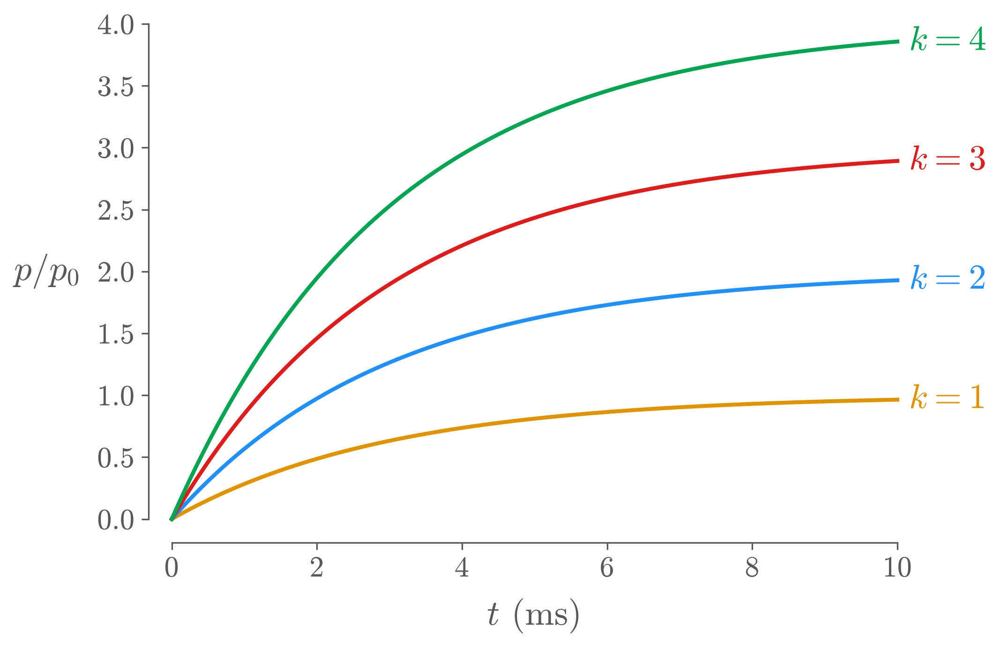
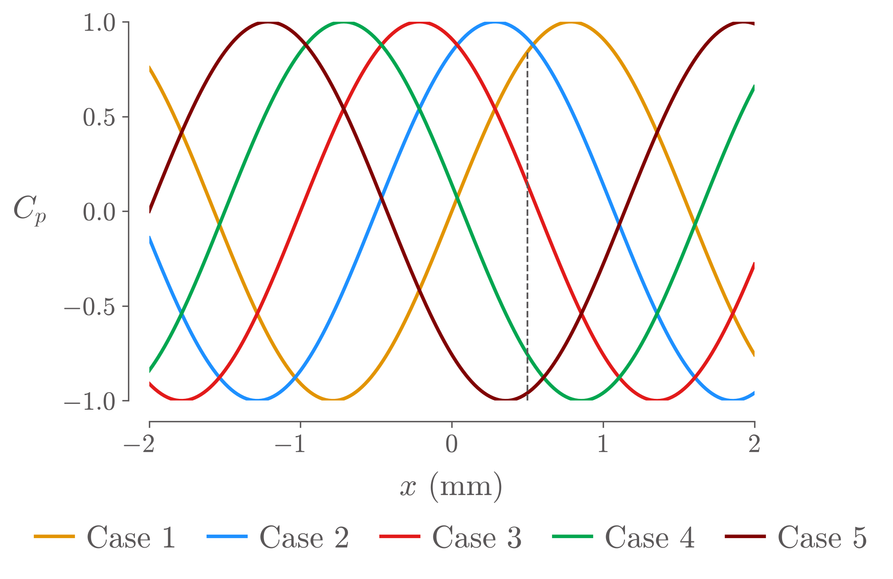
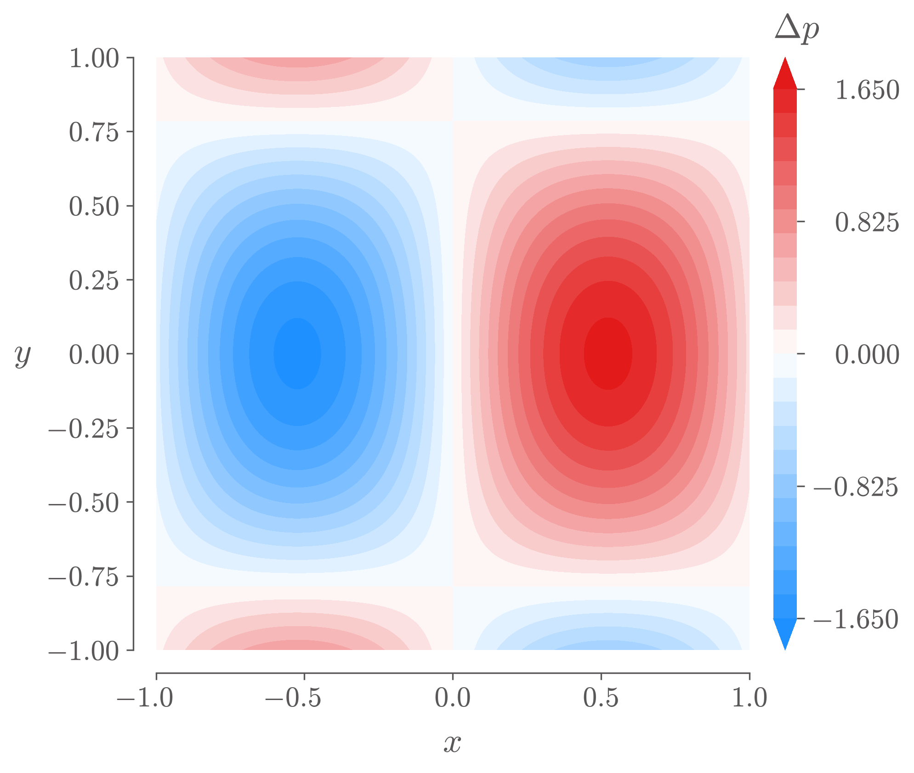
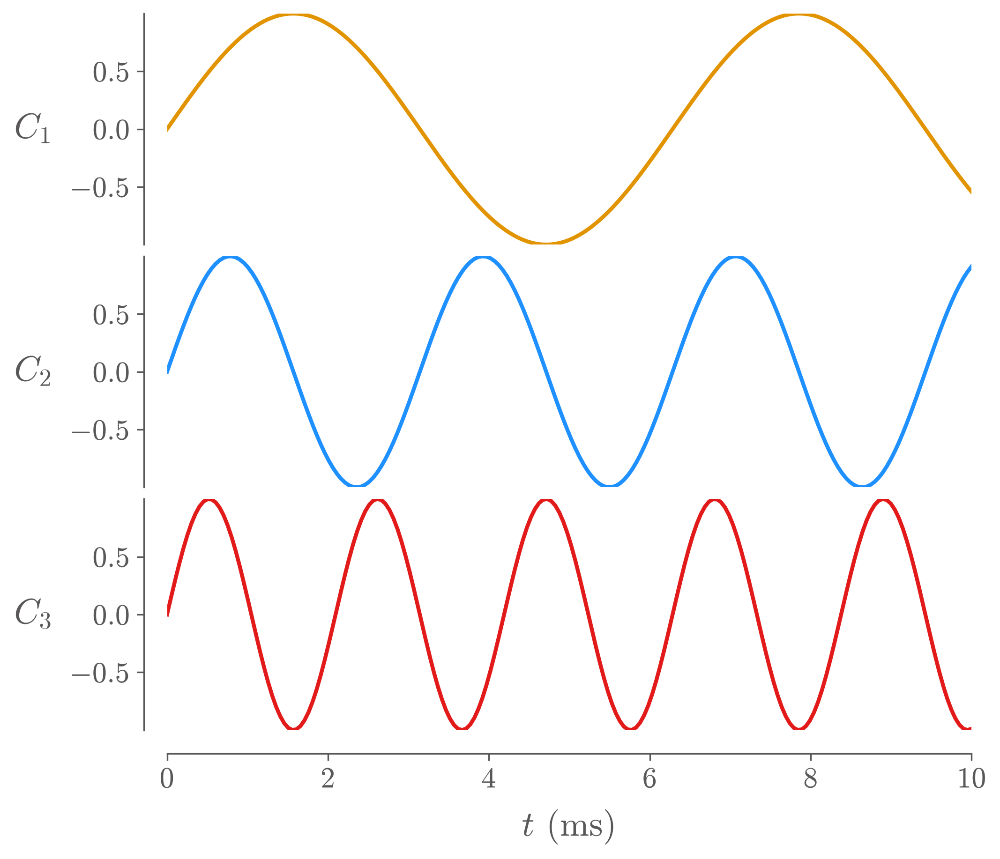

# niceplots skill for Claude Code

A [Claude Code](https://claude.com/claude-code) skill that makes every Python/matplotlib figure Claude draws follow the
[MDO Lab niceplots](https://github.com/mdolab/niceplots) style plus a set of publication rules:

- **All text is set in LaTeX Computer Modern**, so figures match papers set in Computer Modern or Latin Modern (e.g. the AIAA template).
- **Lines are labelled at their ends** when they don't cross. Otherwise a **frameless legend goes below the plot**. There is never a boxed legend.
- **Y labels are horizontal**, and symbols are typeset as math (`$C_p$`, `$\sigma$ (1/s)`).
- **No unneeded lines**: no grid, no top or right border, no full-height reference lines.
- **Colour maps match the data**: sequential for one-signed data, a symmetric blue–white–red map for signed data.
- **Colour bars** are flush with the plot, with end ticks.
- **No label ever touches a line, a marker or other text.** Every saved figure is checked automatically, and Claude looks at the result before showing it to you.

| Separate lines → names at the line ends | Crossing lines → frameless legend below |
|---|---|
|  |  |
| **Signed field → diverging map, flush colour bar** | **Stacked plots → x ticks on the bottom plot only** |
|  |  |

## Install

You need Python with the plotting packages:

```
pip install niceplots matplotlib scipy numpy
```

Then put the `niceplots/` folder where Claude Code looks for skills. Pick one:

**For you, in every project** (personal skill):
```
git clone https://github.com/Stephen-Xiao/Niceplots-skill.git
mkdir -p ~/.claude/skills
cp -R Niceplots-skill/niceplots ~/.claude/skills/
```

**For everyone working in one repository** (project skill): copy the folder to `.claude/skills/niceplots/` at that repository's root and commit it. Anyone who opens Claude Code in the repository gets the skill.

**On claude.ai:**
1. Zip the `niceplots/` folder. The folder name must stay `niceplots`.
2. Upload it under Customize → Skills → Upload a skill.

Note that the claude.ai sandbox may need package installs enabled before it can `pip install niceplots`.

## Use

Ask for a plot and the skill loads on its own. You can also force it with the slash command:

```
/niceplots plot P7/P0 against time in ms from outputs/taps.csv, one line per case, save to figures/
```

Good requests name four things:
- the data file;
- what to plot against what;
- any choices, such as a log scale or a time window;
- where to save the figure.

Claude does the following:
1. Writes a short script that uses the helpers.
2. Runs it.
3. Fixes anything the overlap check reports.
4. Looks at the PNG before handing it over.
5. Saves both a PDF and a 300-dpi PNG.

## Use the helpers without Claude

`niceplots/nicefig.py` is plain Python. Copy it next to your script:

```python
import os, sys
import matplotlib.pyplot as plt
sys.path.insert(0, os.path.dirname(os.path.abspath(__file__)))
import nicefig as nf

colors = nf.setup()                     # niceplots style + LaTeX Computer Modern text
fig, ax = plt.subplots()
ax.plot(x, y, color=colors["Blue"], label="case A")
ax.set_xlabel("$t$ (ms)")
nf.ylabel(ax, "$p/p_0$")                # horizontal y label
nf.finish(ax)                           # no grid, clean outward spines
nf.smart_legend(ax)                     # line-end labels, or a frameless legend below
nf.save(fig, "figures/my_plot")         # checks overlaps, writes .pdf and .png
```

Run `python niceplots/examples/demo.py out_dir` to reproduce the four figures above.

## Files

| File | What it is |
|---|---|
| `niceplots/SKILL.md` | The rules and workflow Claude follows (also readable as a style guide) |
| `niceplots/nicefig.py` | The helper functions: `setup`, `ylabel`, `finish`, `smart_legend`, `color_scale`, `colorbar`, `place_label`, `find_overlaps`, `save`, ... |
| `niceplots/reference.md` | Every niceplots function and its arguments |
| `niceplots/examples/demo.py` | The four example figures |

## Known limitation

The overlap check does not yet treat **unfilled contour lines** (`ax.contour`) as lines. A label sitting on a contour line is not flagged.

Until this is fixed, either redraw important contour curves with `ax.plot` (from `contour.allsegs`) so they are checked, or inspect such labels by eye.
